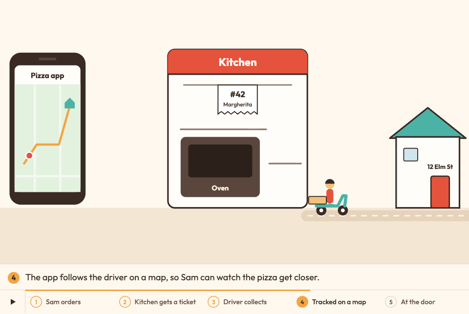

<p align="center">
  <a href="https://wan-huiyan.github.io/wiggle-that-diagram/"></a>
  <br/><sub>The whiteboard style at 2× speed: how an expense claim gets checked, from receipts to payment (made-up example). <a href="https://wan-huiyan.github.io/wiggle-that-diagram/">Watch it with captions, in all three styles →</a></sub>
</p>

<h1 align="center">wiggle-that-diagram 🪱</h1>
<p align="center"><em>A Claude Code skill that makes a "how it works" diagram explain itself, one readable step at a time.</em></p>

<p align="center">
  <a href="LICENSE"></a>
  <a href="https://github.com/wan-huiyan/wiggle-that-diagram/actions/workflows/test.yml"></a>
  <a href="https://github.com/wan-huiyan/wiggle-that-diagram/commits"></a>
  <a href="https://claude.com/claude-code"></a>
  
</p>

> **Ask Claude to "animate this diagram" and get a captioned, looping explainer for your HTML slide deck or report,
> in three styles to pick from, where every step stays on screen long enough to read.**

## 🎞️ The three styles

One caption script feeds all three, so a switcher compares styles, not content.
[**Watch the live films →**](https://wan-huiyan.github.io/wiggle-that-diagram/) (two made-up examples, three styles each)

| Style | Looks like | Made with | Pizza film size |
|---|---|---|---|
| **Diagram clip** | a clean, 3Blue1Brown-style diagram; labels stay sharp | huashu-art-motion engine → text-free video + HTML labels | 423 KB |
| **Whiteboard** | someone explaining at a whiteboard, hand-lettered | huashu-art-motion's whiteboard grammar → square video | 513 KB |
| **Live** | a polished product animation | inline SVG + GSAP with a virtual camera | 21 KB |

<p align="center">
  <a href="https://wan-huiyan.github.io/wiggle-that-diagram/pizza.html"></a>
  <br/><sub>The live style: a pizza order from app to door, step 4 of 5 (made-up example).</sub>
</p>

## ✨ What makes it different

Most explainer animations are too fast to read: the picture moves on while you are still on the caption.
This skill writes the captions first and paces the film around them.

| | What | The specifics |
|---|---|---|
| 📖 | **Readable, not flashy** | Each step holds for at least `max(4.5 s, words/3 + 1.5 s)`, and `pace_check.py` fails any step shorter than its reading time |
| 🔁 | **One story, three ways** | One `beats.json` caption script drives every style |
| 🎞️ | **Behaves inside a deck** | One self-contained file per film in an `iframe srcdoc`: step rail, play/pause, reduced motion, and one gesture still moves one slide |
| ✅ | **Checks that can fail** | A pacing gate, contract tests in real Chrome, edge-clipping checks, size budgets, and reviewers who check every word in the picture against the source |

## 🚀 Install

```bash
/plugin marketplace add wan-huiyan/wiggle-that-diagram
/plugin install wiggle-that-diagram@wan-huiyan-wiggle-that-diagram
```

<details><summary>Already use the cutify-this marketplace?</summary>

wiggle-that-diagram started life in [cutify-this](https://github.com/wan-huiyan/cutify-this), and that marketplace
still lists it, fetched from this repo. This command keeps working:

```bash
/plugin install wiggle-that-diagram@wan-huiyan-cutify-this
```
</details>

## 💬 Usage

```text
You:    animate slide 4, the "how a claim gets approved" diagram, it's too much to take in at once
Claude: [writes the captions first, builds the film in all three styles with a switcher, checks every step
         is on screen long enough to read, and drops it into the slide as one file]
```

The demo sources and the exact rebuild commands are in [`demos/`](demos/README.md).

## ✅ Checks

```bash
bash scripts/check.sh
```

Runs on every push and pull request (the **tests** badge above), 9 checks: every shipped script parses (JavaScript,
Python, bash), the pacing checker passes on the example caption scripts, the live style rebuilds
`demos/final/pizza.html` and `demos/final/expenses.html` byte for byte, and the version agrees in all three places it is written. The browser
contract tests (the skill's `scripts/style-*/test_contract.py`) need Chrome and are run by hand.

## 🙈 Limitations

- **The video styles need tools:** `uv`, Google Chrome, ffmpeg and a copy of the
  [huashu-art-motion](https://github.com/alchaincyf/huashu-art-motion) skill. The live style needs only Python.
- **Video styles are heavy.** The six example films run 423 to 818 KB each in the video styles, against 21 to 24 KB
  for the live style (budget: 900 KB and 40 KB).
- **"Readable" is measured, "clear" is not.** The pacing gate proves each step is on screen long enough; whether the
  picture explains anything is still judged by eye.
- **Claude Code first.** Other agents can read `SKILL.md`, but the install commands assume Claude Code.

## 💛 Credits

- **[huashu-art-motion](https://github.com/alchaincyf/huashu-art-motion)** by 花叔 (alchaincyf, MIT): the direction
  method and the rendering engine under the two video styles.
- The live style uses [GSAP](https://gsap.com) and the fonts [Outfit](https://fonts.google.com/specimen/Outfit) and
  [Kalam](https://fonts.google.com/specimen/Kalam) (OFL); see
  [`THIRD_PARTY_NOTICES.md`](plugins/wiggle-that-diagram/skills/wiggle-that-diagram/THIRD_PARTY_NOTICES.md).

Made by Huiyan Wan with **Claude** (Anthropic) in Claude Code. Earlier history (1.0 to 1.3.0) happened in
[cutify-this](https://github.com/wan-huiyan/cutify-this) and came along with the move.

## License

MIT, see [LICENSE](LICENSE).
