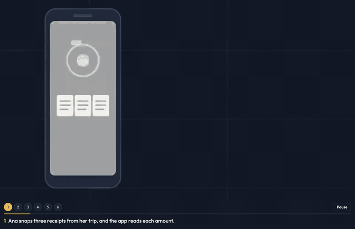
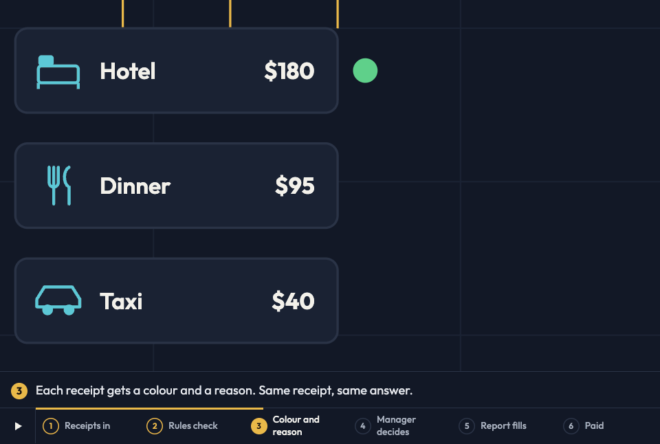
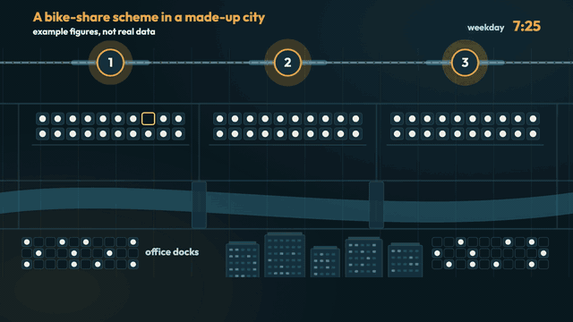

<h1 align="center">wiggle-that-diagram 🪱</h1>
<p align="center"><em>A Claude Code skill that makes a "how it works" diagram explain itself, one readable step at a time.</em></p>

<table>
<tr>
<td width="50%" align="center"><a href="https://wan-huiyan.github.io/wiggle-that-diagram/expenses-whiteboard.html"></a><br/><sub><b>Whiteboard</b>: hand-drawn, like someone explaining at a board · <a href="https://wan-huiyan.github.io/wiggle-that-diagram/expenses-whiteboard.html">open live</a></sub></td>
<td width="50%" align="center"><a href="https://wan-huiyan.github.io/wiggle-that-diagram/expenses-diagram.html"></a><br/><sub><b>Diagram clip</b>: a clean diagram, labels stay sharp · <a href="https://wan-huiyan.github.io/wiggle-that-diagram/expenses-diagram.html">open live</a></sub></td>
</tr>
<tr>
<td width="50%" align="center"><a href="https://wan-huiyan.github.io/wiggle-that-diagram/expenses.html"></a><br/><sub><b>Live</b>: SVG and GSAP, the whole six-step film is 23 KB · <a href="https://wan-huiyan.github.io/wiggle-that-diagram/expenses.html">open live</a></sub></td>
<td width="50%" align="center"><a href="https://wan-huiyan.github.io/wiggle-that-diagram/films.html"></a><br/><sub><b>Long film</b>: a 1 to 3 minute silent film, rendered to MP4 · <a href="https://wan-huiyan.github.io/wiggle-that-diagram/films.html">watch</a></sub></td>
</tr>
</table>
<p align="center"><sub>Every example is made up: an expense claim in the three loop styles (sped up 2×), and a bike-share data story as a film.</sub></p>

<p align="center">
  <a href="LICENSE"></a>
  <a href="https://github.com/wan-huiyan/wiggle-that-diagram/actions/workflows/test.yml"></a>
  <a href="https://github.com/wan-huiyan/wiggle-that-diagram/commits"></a>
  <a href=".claude-plugin/marketplace.json"></a>
  <a href="https://claude.com/claude-code"></a>
</p>

> **Ask Claude to "animate this diagram" and get an explainer where every step stays on screen long enough to read:
> a captioned loop for your HTML slide deck or report, in three styles to pick from, or a 1 to 3 minute silent film
> rendered to MP4.**

## 🤔 Why it exists

Most explainer animations are too fast to read: the picture moves on while you are still on the caption. This skill
writes the captions first, paces the film around them, and fails any step that is shorter than its reading time.
One caption script feeds all three loop styles, so a switcher compares styles, not content.

## ✨ What makes it different

| | What | The specifics |
|---|---|---|
| 📖 | **Readable, not flashy** | Each step holds for at least `max(4.5 s, words/3 + 1.5 s)`, and `pace_check.py` fails any step shorter than its reading time |
| 🔁 | **One story, three ways** | One `beats.json` caption script drives the diagram clip, the whiteboard and the live style |
| 🎞️ | **Behaves inside a deck** | One self-contained file per loop in an `iframe srcdoc`: step rail, play/pause, reduced motion, and one gesture still moves one slide |
| 🎬 | **Films that count honestly** | The long film builds its charts from the scene's own objects (empty docks, gold book spines) and checks its own sums before it renders |
| ✅ | **Checks that can fail** | A pacing gate, contract tests in real Chrome, edge-clipping checks, size budgets, and reviewers who check every word in the picture against the source |

## 🎞️ The four styles

[**Watch the loops live →**](https://wan-huiyan.github.io/wiggle-that-diagram/) (two made-up examples, three styles each, with a switcher)
· [**Watch the films →**](https://wan-huiyan.github.io/wiggle-that-diagram/films.html)

| Style | Looks like | Made with | Watch: expense claim | Watch: pizza order |
|---|---|---|---|---|
| **A · Diagram clip** | a clean, 3Blue1Brown-style diagram; labels stay sharp | huashu-art-motion engine → text-free video + HTML labels | [film](https://wan-huiyan.github.io/wiggle-that-diagram/expenses-diagram.html) · 435 KB | [film](https://wan-huiyan.github.io/wiggle-that-diagram/pizza-diagram.html) · 423 KB |
| **B · Whiteboard** | someone explaining at a whiteboard, hand-lettered | huashu-art-motion's whiteboard grammar → square video | [film](https://wan-huiyan.github.io/wiggle-that-diagram/expenses-whiteboard.html) · 818 KB | [film](https://wan-huiyan.github.io/wiggle-that-diagram/pizza-whiteboard.html) · 513 KB |
| **C · Live** | a polished product animation | inline SVG + GSAP with a virtual camera | [film](https://wan-huiyan.github.io/wiggle-that-diagram/expenses.html) · 23 KB | [film](https://wan-huiyan.github.io/wiggle-that-diagram/pizza.html) · 21 KB |
| **D · Long film** | a silent explainer or data story, 10 to 20 shots | one SVG page with a small drawing kit → MP4, 1920×1080 | [bike-share, 58 s](https://wan-huiyan.github.io/wiggle-that-diagram/films.html) · 4.2 MB | [library, 29 s](https://wan-huiyan.github.io/wiggle-that-diagram/films.html) · 1.0 MB |

## 🚀 Install

```bash
/plugin marketplace add wan-huiyan/wiggle-that-diagram
/plugin install wiggle-that-diagram@wan-huiyan-wiggle-that-diagram
```

<details><summary>Already use the cutify-this marketplace?</summary>

wiggle-that-diagram started life in [cutify-this](https://github.com/wan-huiyan/cutify-this), and that marketplace
still lists it, fetched from this repo. This command keeps working:

```bash
/plugin install wiggle-that-diagram@wan-huiyan-cutify-this
```
</details>

## 💬 Usage

```text
You:    animate slide 4, the "how a claim gets approved" diagram, it's too much to take in at once
Claude: [writes the captions first, builds the loop in all three styles with a switcher, checks every step
         is on screen long enough to read, and drops it into the slide as one file]
```

```text
You:    make a one-minute film for the team about why our bike docks run empty by 9am
Claude: [writes the one sentence the film should leave, builds the shots from docks and bikes, sets each shot's
         length from the words it draws, checks the drawn counts add up, and renders the MP4]
```

The demo sources and the exact rebuild commands are in [`demos/`](demos/README.md).

## 🎬 The long film (style D)

When a loop is not enough, style D tells one story in 10 to 20 shots, drawn as a single SVG page and rendered to an
MP4 (1920×1080, 30 fps). The 2-minute film at the top of
[no-ask-left-behind](https://github.com/wan-huiyan/no-ask-left-behind#readme) was made this way, and its source ships
as the worked example in `examples/loop-promo/`.

<p align="center">
  <a href="https://wan-huiyan.github.io/wiggle-that-diagram/films.html"></a>
  <br/><sub>The library film at 1.5×, made-up figures: one gold spine is 1% of a branch's loans before June. <a href="https://wan-huiyan.github.io/wiggle-that-diagram/films.html">Watch both films →</a></sub>
</p>

- **A small drawing kit** (`kit.js`): a camera, captions, people, speech, and one shape per meaning (a tape for a
  list, a dial for a score, a balance for a check, a lamp for pass or fail), so frames are pictures, not slides.
  `units()` draws a count as the scene's own objects, lit or unlit.
- **Pacing from what is actually drawn:** `film_beats.js` counts the words on screen in every shot, `fit_durs.py`
  prints shot lengths that pass the reading rule.
- **Checks before the long render:** `render.py --per-shot` makes a contact sheet of every shot and lists any label
  the frame edge cuts. A data film carries its own sums and refuses to render when the drawn counts do not add up.

Start with `python3 scripts/style-d/new_film.py <folder>`; the method is in
[`references/long-film.md`](plugins/wiggle-that-diagram/skills/wiggle-that-diagram/references/long-film.md).
Film sources: [`demos/films/`](demos/films/).

## ✅ Checks

```bash
bash scripts/check.sh
```

Runs on every push and pull request (the **tests** badge above), 10 checks: every shipped script parses (JavaScript,
Python, bash), the pacing checker passes on the example caption scripts, the live style rebuilds
`demos/final/pizza.html` and `demos/final/expenses.html` byte for byte, the long-film example passes the pacing
check on the words it actually draws, and the version agrees in all three places it is written. The browser
contract tests (the skill's `scripts/style-*/test_contract.py`) need Chrome and are run by hand.

## 🙈 Limitations

- **The video styles need tools:** `uv`, Google Chrome, ffmpeg and a copy of the
  [huashu-art-motion](https://github.com/alchaincyf/huashu-art-motion) skill. The live style needs only Python.
  The long film (style D) needs node, `uv` (Playwright) and ffmpeg, plus huashu-art-motion for the
  film gate at delivery.
- **Video is heavy.** The four example loops in the video styles run 423 to 818 KB each, against 21 to 23 KB for the
  live style (budget: 900 KB and 40 KB). The two example films are 1.0 MB (29 s) and 4.2 MB (58 s) after re-encoding
  for the web.
- **"Readable" is measured, "clear" is not.** The pacing gate proves each step is on screen long enough; whether the
  picture explains anything is still judged by eye, and the example films each needed five rounds of review.
- **Claude Code first.** Other agents can read `SKILL.md`, but the install commands assume Claude Code.

## 💛 Credits

- **[huashu-art-motion](https://github.com/alchaincyf/huashu-art-motion)** by 花叔 (alchaincyf, MIT): the direction
  method and the rendering engine under the two video styles.
- The long film bundles the Outfit font (OFL). The live style uses [GSAP](https://gsap.com) and the fonts [Outfit](https://fonts.google.com/specimen/Outfit) and
  [Kalam](https://fonts.google.com/specimen/Kalam) (OFL); see
  [`THIRD_PARTY_NOTICES.md`](plugins/wiggle-that-diagram/skills/wiggle-that-diagram/THIRD_PARTY_NOTICES.md).

Made by Huiyan Wan with **Claude** (Anthropic) in Claude Code. Earlier history (1.0 to 1.3.0) happened in
[cutify-this](https://github.com/wan-huiyan/cutify-this) and came along with the move.

## License

MIT, see [LICENSE](LICENSE).
