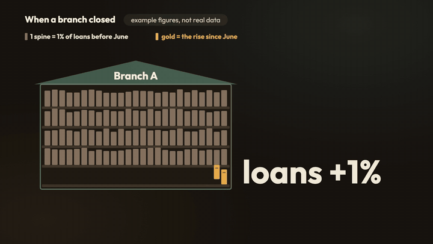
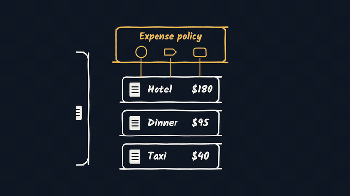

<h1 align="center">wiggle-that-diagram 🪱</h1>
<p align="center"><em>A Claude Code skill that turns your diagram or your data into a short explainer people can actually read.</em></p>

<table>
<tr>
<td width="50%" align="center" valign="top"><a href="https://wan-huiyan.github.io/wiggle-that-diagram/films.html"></a><br/><sub><b>Why the station docks run empty by 9:00</b> · 58 s film · <a href="https://wan-huiyan.github.io/wiggle-that-diagram/films.html">watch</a></sub></td>
<td width="50%" align="center" valign="top"><a href="https://wan-huiyan.github.io/wiggle-that-diagram/films.html"></a><br/><sub><b>What happened when a branch closed</b> · 29 s film · <a href="https://wan-huiyan.github.io/wiggle-that-diagram/films.html">watch</a></sub></td>
</tr>
</table>
<p align="center"><sub>Two made-up data stories, one method. Each picture is drawn from its own subject (bike docks that empty, book spines that light up), not from a template.</sub></p>

<p align="center">
  <a href="LICENSE"></a>
  <a href="https://github.com/wan-huiyan/wiggle-that-diagram/actions/workflows/test.yml"></a>
  <a href="https://claude.com/claude-code"></a>
</p>

> **Give Claude your diagram or your data: it finds the one point, writes the captions first, draws the story from
> your subject's own things, and will not ship a step you cannot read or a number that does not add up.**

<p align="center"><b><a href="#-install">Install</a></b> · <a href="https://wan-huiyan.github.io/wiggle-that-diagram/">Watch the loops live</a> · <a href="https://wan-huiyan.github.io/wiggle-that-diagram/films.html">Watch the films</a></p>

## 🧭 How it works

Most explainer animations are too fast to read and say too many things at once. This skill works in the other order:

1. **Find the one point.** One sentence the viewer should leave with, and at most three numbers that carry it.
   Everything else is cut, however true.
2. **Write the captions first.** Every step's words are written before anything moves, and each step is held long
   enough to read them.
3. **Draw it from the subject.** A bike-share story is told with docks that empty; a library story with book spines
   that light up. The skill picks a world from your subject's own nouns, so two stories do not come out looking alike.
4. **Check before it ships.** A step too short to read, a label cut off by the frame, or a drawn count that does not
   match its caption each fail a check.

## ✨ What makes it different

| | What | The specifics |
|---|---|---|
| 🎯 | **One point, not everything** | One sentence, at most three numbers, and a table that ties each number to the words it supports |
| 📖 | **Readable, not flashy** | Each step holds for at least `max(4.5 s, words/3 + 1.5 s)`, counting the caption and every newly drawn word; `pace_check.py` fails any step shorter than that |
| 🧱 | **Your subject, not a template** | Charts are built from the scene's own objects (empty docks, gold book spines), and each idea keeps one shape for the whole film |
| ✅ | **Checks that can fail** | A pacing gate, edge-clipping checks, films that refuse to render when their drawn counts do not add up, and reviewers who check every word against the source |
| 🎞️ | **Fits where you need it** | A loop drops into a slide or report as one self-contained file (step rail, play/pause, reduced motion); a film renders to MP4 |

## 🎞️ Output formats

The format is the last choice, not the first. The same captions can be rendered as any of the three loops; the
[live site](https://wan-huiyan.github.io/wiggle-that-diagram/) shows both loop stories in all three, with a switcher.

<p align="center">
  <a href="https://wan-huiyan.github.io/wiggle-that-diagram/expenses-whiteboard.html"></a>
  <br/><sub>A loop for a slide: how an expense claim gets checked, whiteboard format at 2× (made-up). <a href="https://wan-huiyan.github.io/wiggle-that-diagram/expenses-whiteboard.html">Open live →</a></sub>
</p>

| Format | Looks like | Made with | Expense claim | Pizza order |
|---|---|---|---|---|
| **A · Diagram clip** (loop) | a clean, 3Blue1Brown-style diagram; labels stay sharp | huashu-art-motion engine → text-free video + HTML labels | [open](https://wan-huiyan.github.io/wiggle-that-diagram/expenses-diagram.html) · 435 KB | [open](https://wan-huiyan.github.io/wiggle-that-diagram/pizza-diagram.html) · 423 KB |
| **B · Whiteboard** (loop) | someone explaining at a whiteboard, hand-lettered | huashu-art-motion's whiteboard grammar → square video | [open](https://wan-huiyan.github.io/wiggle-that-diagram/expenses-whiteboard.html) · 818 KB | [open](https://wan-huiyan.github.io/wiggle-that-diagram/pizza-whiteboard.html) · 513 KB |
| **C · Live** (loop) | a polished product animation | inline SVG + GSAP with a virtual camera | [open](https://wan-huiyan.github.io/wiggle-that-diagram/expenses.html) · 23 KB | [open](https://wan-huiyan.github.io/wiggle-that-diagram/pizza.html) · 21 KB |
| **D · Long film** | a 1 to 3 minute silent explainer or data story | one SVG page with a small drawing kit → MP4, 1920×1080 | [bike-share, 58 s](https://wan-huiyan.github.io/wiggle-that-diagram/films.html) · 4.2 MB | [library, 29 s](https://wan-huiyan.github.io/wiggle-that-diagram/films.html) · 1.0 MB |

## 🚀 Install

```bash
/plugin marketplace add wan-huiyan/wiggle-that-diagram
/plugin install wiggle-that-diagram@wan-huiyan-wiggle-that-diagram
```

<details><summary>Already use the cutify-this marketplace?</summary>

wiggle-that-diagram started life in [cutify-this](https://github.com/wan-huiyan/cutify-this), and that marketplace
still lists it, fetched from this repo. This command keeps working:

```bash
/plugin install wiggle-that-diagram@wan-huiyan-cutify-this
```
</details>

## 💬 Usage

```text
You:    animate slide 4, the "how a claim gets approved" diagram, it's too much to take in at once
Claude: [writes the captions first, builds the loop in all three styles with a switcher, checks every step
         is on screen long enough to read, and drops it into the slide as one file]
```

```text
You:    make a one-minute film for the team about why our bike docks run empty by 9am
Claude: [writes the one sentence the film should leave, builds the shots from docks and bikes, sets each shot's
         length from the words it draws, checks the drawn counts add up, and renders the MP4]
```

The demo sources and the exact rebuild commands are in [`demos/`](demos/README.md).

## 🎬 The long film (style D)

When a loop is not enough, style D tells one story in 10 to 20 shots, drawn as a single SVG page and rendered to an
MP4 (1920×1080, 30 fps). The 2-minute film at the top of
[no-ask-left-behind](https://github.com/wan-huiyan/no-ask-left-behind#readme) was made this way, and its source ships
as the worked example in `examples/loop-promo/`. The two data films at the top are in [`demos/films/`](demos/films/).

- **A small drawing kit** (`kit.js`): a camera, captions, people, speech, and one shape per meaning (a tape for a
  list, a dial for a score, a balance for a check, a lamp for pass or fail), so frames are pictures, not slides.
  `units()` draws a count as the scene's own objects, lit or unlit.
- **Pacing from what is actually drawn:** `film_beats.js` counts the words on screen in every shot, `fit_durs.py`
  prints shot lengths that pass the reading rule.
- **Checks before the long render:** `render.py --per-shot` makes a contact sheet of every shot and lists any label
  the frame edge cuts. A data film carries its own sums and refuses to render when the drawn counts do not add up.

Start with `python3 scripts/style-d/new_film.py <folder>`; the method is in
[`references/long-film.md`](plugins/wiggle-that-diagram/skills/wiggle-that-diagram/references/long-film.md).

## ✅ Checks

```bash
bash scripts/check.sh
```

Runs on every push to `main` and every pull request (the **tests** badge above), 10 checks: every shipped script parses (JavaScript,
Python, bash), the pacing checker passes on the example caption scripts, the live style rebuilds
`demos/final/pizza.html` and `demos/final/expenses.html` byte for byte, the long-film example passes the pacing
check on the words it actually draws, and the version agrees in all three places it is written. The browser
contract tests (the skill's `scripts/style-*/test_contract.py`) need Chrome and are run by hand.

## 🙈 Limitations

- **The video styles need tools:** `uv`, Google Chrome, ffmpeg and a copy of the
  [huashu-art-motion](https://github.com/alchaincyf/huashu-art-motion) skill. The live style needs only Python.
  The long film (style D) needs node, `uv` (Playwright) and ffmpeg, plus huashu-art-motion for the
  film gate at delivery.
- **Video is heavy.** The four example loops in the video styles run 423 to 818 KB each, against 21 to 23 KB for the
  live style (budget: 900 KB and 40 KB). The two example films are 1.0 MB (29 s) and 4.2 MB (58 s) after re-encoding
  for the web.
- **"Readable" is measured, "clear" is not.** The pacing gate proves each step is on screen long enough; whether the
  picture explains anything is still judged by eye, and the example films each needed five rounds of review.
- **Claude Code first.** Other agents can read `SKILL.md`, but the install commands assume Claude Code.

## 💛 Credits

- **[huashu-art-motion](https://github.com/alchaincyf/huashu-art-motion)** by 花叔 (alchaincyf, MIT): the direction
  method and the rendering engine under the two video styles.
- The long film bundles the Outfit font (OFL). The live style uses [GSAP](https://gsap.com) and the fonts [Outfit](https://fonts.google.com/specimen/Outfit) and
  [Kalam](https://fonts.google.com/specimen/Kalam) (OFL); see
  [`THIRD_PARTY_NOTICES.md`](plugins/wiggle-that-diagram/skills/wiggle-that-diagram/THIRD_PARTY_NOTICES.md).

Made by Huiyan Wan with **Claude** (Anthropic) in Claude Code. Earlier history (1.0 to 1.3.0) happened in
[cutify-this](https://github.com/wan-huiyan/cutify-this) and came along with the move.

## License

MIT, see [LICENSE](LICENSE).
